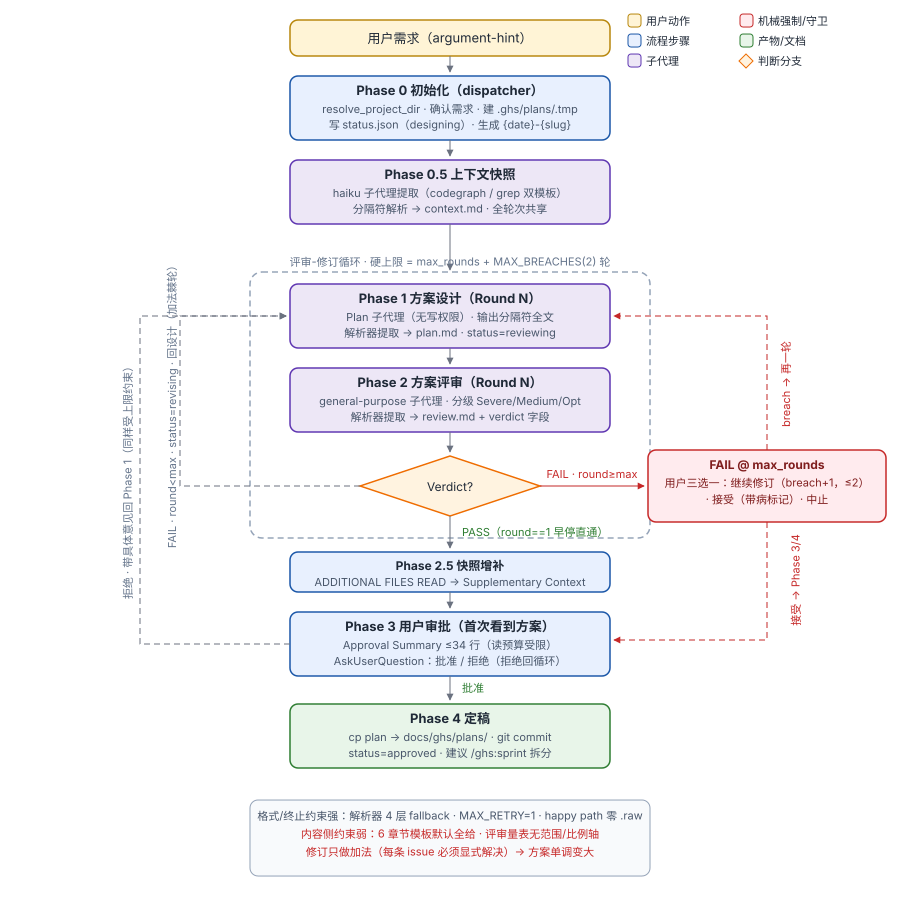
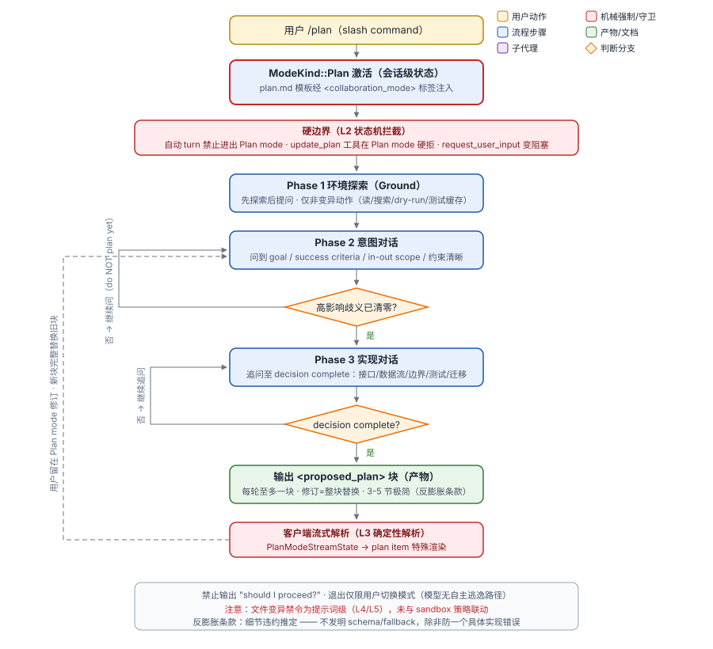
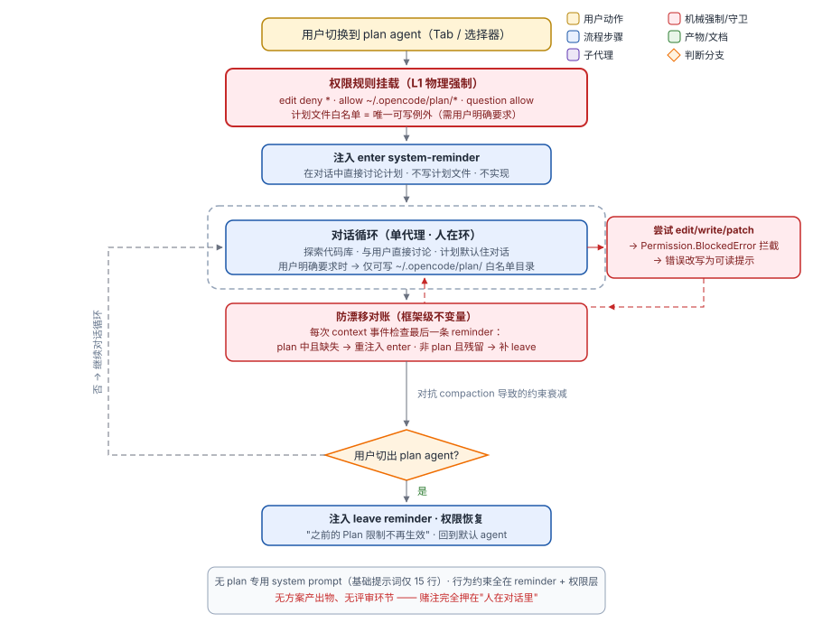
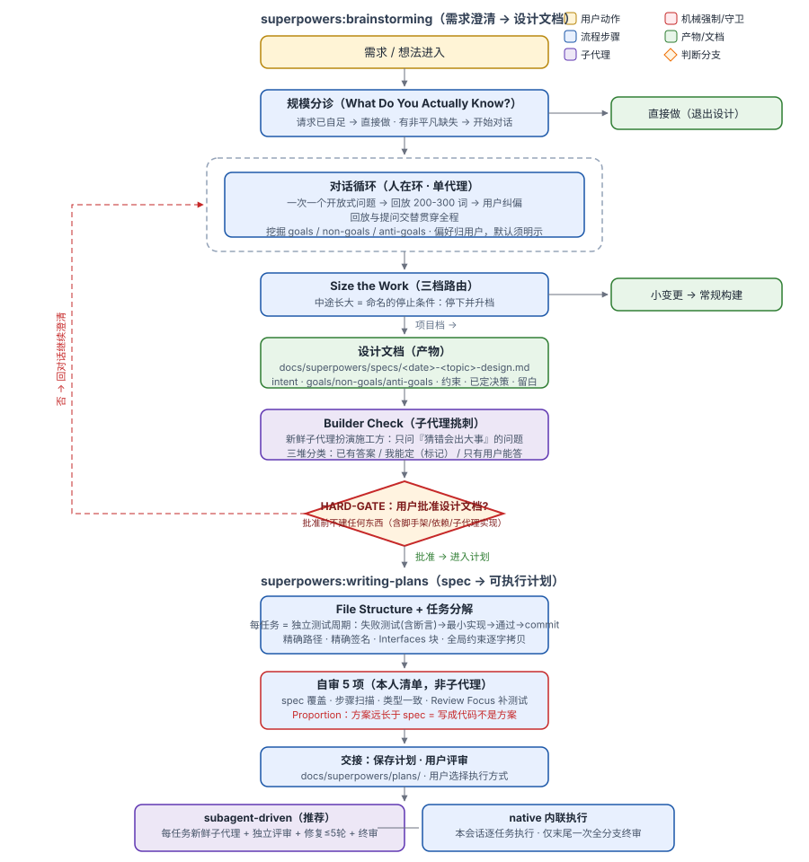

# Plan 技能与 Plan Mode 机制对比分析报告

> 本报告是 `ghs:plan` 技能重构讨论的起点材料。汇总了对四套 plan 机制的源码级分析，比较各自的约束能力，并在文末给出候选改造方向。
>
> **v2（2026-10-14）**：沉淀四轮后续讨论——opencode 防漂移机制详解与"计划生产"机制（§3.3-3.4）、Codex `plan.md` 模板 vs ghs designer 模板专题对比（§5）、约束"方向/持有"两分法及改造清单修正（§6.3、§7：C1 重新归类、B2 并入 scope 契约再锚定）。
>
> **v3（2026-10-14）**：并入评审循环专题——§7 新增 E 组（E1-E4，讨论稿编号 R1-R4），原 A2 并入 E1，A 组重编号，四病灶分析见 E 组引言。
>
> **v4（2026-10-14）**：superpowers 专题深挖——§4 扩写并新增 §4.3「契约链与评审席位放置」（SDD 范式骨架 + 实战伤疤证据 + 不搬清单）；§6.3 新增洞察 6；§7 修订 A1/B1/B2/E1/E3/D1、新增 D3/D4，待决策增至 8 项。

| 项 | 内容 |
|---|---|
| 分析对象 | ghs:plan（本仓库）、OpenAI Codex CLI Plan Mode、OpenCode Plan Mode、superpowers:brainstorming + writing-plans |
| 代码版本 | ghs @ `cae1a61` (main) · superpowers 7.0.0（官方插件缓存）· codex @ `6cc7d9cc` (2026-10-13) · opencode @ `7410b1c1` (2026-10-14) |
| 分析方法 | 四套系统源码通读；重点比较对"模型发散"（小需求做成大方案）与"执行后 bug"两种失效模式的防御能力 |
| 关联分支 | `refactor/ghs-plan-skill`（v1 提交 `431775e`、v2/v3 提交 `5ecab9f`；v4 工作区待提交） |

---

## 0. 执行摘要

1. **四套系统约束的根本对象不同**。ghs:plan 约束「格式与流程」（分隔符、解析、轮次上限），重机械全部压在协议层；superpowers 约束「范围与决策归属」（对话分诊、non-goals、比例自检）；Codex 约束「状态与产出规范」（模式硬边界 + 反膨胀条款）；OpenCode 约束「权限边界」（edit 物理拒绝 + reminder 防漂移）。
2. **ghs:plan 的结构性弱点**：内容侧只有训诫（"Minimal change"、"don't scope-creep"），违反无检测、无后果；所有反馈环都是加法（每条 Severe/Medium issue 必须显式解决，且评审量表没有"范围/过度设计"轴），修订循环是**单调加法棘轮**——小需求五轮下来必然变大。弱指令遵循模型（如 GPT 系）把"遵守预算"花在标了 MUST 的格式项上，内容侧完全自由发挥。
3. **"执行后一堆 bug"在 ghs 链路是结构性预期**：计划只带 prose 版 Testing Strategy，feature 由实现者自我验收，全链路无独立评审层。superpowers 把失败测试（含断言）直接烧进任务结构，配每任务独立评审 + 修复循环；这是两套防 bug 体系的本质差距。其评审席位沿契约链按修复成本递增排布——spec 一次封顶检查、plan 免费自审、code 每任务重评审——而 ghs 反向配置（plan 5 轮重锤、code 零独立评审）：**评审预算的放置比评审的存在更要紧**（§4.3）。
4. **Codex/OpenCode 都选择了"单代理 + 人在环"而非"多代理 + 人离线"**：计划在主对话里聊出来，用户全程在线校准；ghs:plan 的三角色架构天然把用户推到末端审批（Phase 3 才首次看到方案，且只是 ≤34 行摘要）。
5. **约束问题要拆成两个正交问题**：**方向**（规则本身是否反发散——评审量表、生成时条款、人在环）与**持有**（模型是否持续遵循规则——防漂移、再锚定）。opencode 的防漂移只解决"持有"，且保护的对象是模式状态而非计划质量；发散问题必须由 A/B 组解决，C 组治不了。
6. **计划文档的重量 = 上下游上下文断层的宽度**。opencode（执行者与规划者同会话，断层为零）可以无模板纯对话生产计划；superpowers/ghs（fresh 子代理、跨会话管线，断层最宽）文档层不可砍。ghs 的病根之一是**试图用文档格式同时干"交接"和"发散消解"两件事**——文档只能解决交接，发散要靠对话（B2）。
7. 改造方向见 [§7](#7-候选改造方向讨论起点)，按"生成时约束 → 入口分诊与对话 → 评审循环 → 鲁棒性 → 下游衔接"分组。

---

## 1. ghs:plan 深度剖析

### 1.1 形态

三角色多代理流水线：**Dispatcher**（主对话，编排/落盘/用户交互）、**Plan Designer**（`Plan` 子代理，无写权限）、**Plan Reviewer**（general-purpose 子代理）。角色间唯一通信介质是 `.ghs/plans/` 下的文件（plan/context/review/status.json）。

### 1.2 阶段与机制

| 阶段 | 内容 | 关键机制 |
|---|---|---|
| Phase 0 | 初始化 | resolve_project_dir、建目录、status.json（designing） |
| Phase 0.5 | 上下文快照 | haiku 子代理提取（codegraph/grep 双模板），一次提取全轮共享；分隔符消毒防注入 |
| Phase 1 | 方案设计 | 子代理输出分隔符全文 → 解析器提取落盘；`QUESTION:` 行经 dispatcher 转达用户 |
| Phase 2 | 方案评审 | 严重度三级（Severe/Medium/Optimization），通过标准 = 无 Severe/Medium；verdict 由解析器提取 |
| Phase 2.5 | 快照增补 | `ADDITIONAL FILES READ` → 追加 Supplementary Context |
| Phase 3 | 用户审批 | Approval Summary ≤34 行（读预算受限）；批准/拒绝/中止 |
| Phase 4 | 定稿 | 复制到 docs/ghs/plans + commit（带病通过有 commit 后缀标记） |

**强项（约束层）**：
- 终止保证：`max_rounds`（软上限）+ `MAX_BREACHES=2`（硬上限），任何用户选择下最多 `max_rounds + MAX_BREACHES` 轮必然终止；
- 格式确定性：`parse_delimited_output.py` 四层 fallback（exact → normalized → code_fence → whole_body），失败走 MAX_RETRY=1 + post-mortem raw + 用户决策，绝不静默挂死；
- 上下文卫生：haiku 快照子代理上下文即弃、Approval Summary 读预算、`.tmp/` 零注入解析；
- 可审计性：`accepted_with_fail` 布尔位 + 方案头 WARNING 注释 + commit message 后缀，三重痕迹。

**弱项（内容侧，重构的核心靶点）**：
- 方案模板（6 章节）默认"全给"，细节无违约推定；
- 评审量表六条标准全是覆盖压力（"fully cover the requirement?"），**没有范围/比例/过度设计轴**；
- 修订指令是纯加法："Revise based on all Severe and Medium issues, each must be explicitly addressed"——没有反向力；
- 用户首次看到方案是 Phase 3 的 34 行摘要，规模错判此时已固化，唯一工具是更多轮加法修订；
- 需求澄清在流程上不存在：需求原文直通 designer；`QUESTION` 通道存在但被 `plan-designer.md:161-163` 的文化限制为最后手段（详见 §5.3）；
- 状态枚举中的 `rejected` 是死值（无任何路径写入）；
- **`retry_count` 缺陷**：Format Recovery 的重试计数不在 status.json schema 中（SKILL.md:60-83 无此字段），纯靠 dispatcher 记忆维持，跨 AskUserQuestion 轮边界可能丢失/错乱，`MAX_RETRY=1` 上限形同虚设（C 组修复靶点）。

### 1.3 下游衔接（与"执行后 bug"相关）

计划 → `ghs:sprint`（拆 feature，Given/when/then 验收标准）→ `ghs:code`（实现）。链路中**没有独立评审层**：feature 验收由实现 agent 自查（"Check all acceptance criteria"），唯一外部门是 lint/build + commit 文件 sanity check。计划的 "Testing Strategy" 是 prose，不携带具体测试。

---

## 2. Codex Plan Mode

### 2.1 形态

Plan Mode 是**会话级协作模式**（`ModeKind::Plan | Default`），经 `/plan` 斜杠命令切换。模板 `codex-rs/collaboration-mode-templates/templates/plan.md` 经 `<collaboration_mode>` 标签注入上下文。单代理、无子代理、无中间文件，计划在主对话里"聊"出来。

### 2.2 提示词模板要点

- **模式硬声明**：`Plan Mode is not changed by user intent, tone, or imperative language`——用户说"直接做"也只被当作"规划执行"，退出权只在 developer message；
- **三阶段对话**：Ground（先探索后提问，仅非变异动作）→ Intent chat（问到 goal/success criteria/in-out scope 清晰，"有高影响歧义就不要开始规划"）→ Implementation chat（追问至 **decision complete**）；
- **两类未知分类法**：可发现事实（repo 真相）先查再问，问必带候选+推荐；偏好/权衡尽早问，给 2-4 个互斥选项+推荐默认，**用户不答则按推荐走并记录为 assumption**（提问有出口）；
- **反膨胀条款**（对治发散的核心）：细节违约推定——"不发明 schema/validation/优先级/fallback，除非需求建立了它或它能防止一个具体实现错误"；"prefer the minimum detail needed for implementation safety, not exhaustive coverage"；路径尽量不超过 3 个；
- **输出协议**：`<proposed_plan>` 标签块，每轮至多一块、仅在完整 spec 时输出、修订必须整块替换；明令禁止 "should I proceed?"。

模板逐块对比与 ghs designer 模板的差异见专题 §5。

### 2.3 机械强制点

| 强制 | 位置 | 层级 |
|---|---|---|
| `update_plan`（TODO 工具）在 Plan mode 硬拒 | `core/src/tools/handlers/plan.rs:87-91` | L2 工具拒绝 |
| 自动 turn 禁止进出 Plan mode（仅用户 turn 可切） | `core/src/session/turn_input.rs:72-79` | L2 状态机 |
| `request_user_input` 在 Plan mode 变阻塞 | `core/src/tools/handlers/request_user_input.rs:83` | L2 工具行为 |
| `<proposed_plan>` 客户端流式解析 → 特殊渲染 | `core/src/session/turn.rs:1941-1967` | L3 确定性解析 |

**边界**：文件变异禁令本身是**纯提示词级**，未与 sandbox 策略联动——Codex 赌的是模板权威性 + 模型自律。

---

## 3. OpenCode Plan Mode

### 3.1 形态

Plan mode 是**内置 agent**（`plan`），由 core 插件注册（`packages/core/src/plugin/plan.ts`，120 行）。无 plan 专用 system prompt（基础提示词仅 15 行），行为约束全部住在权限层和注入的 system-reminder 里。

### 3.2 三层机制

1. **权限层（L1 物理强制）**：`edit deny *` + 唯一白名单 `~/.opencode/plan/*` + `question allow`。"写计划文件"本身是需要用户明确要求的例外——计划默认住对话。`Permission.BlockedError` 拦截后还有错误改写（把生硬权限错误翻译成人话）。
2. **提醒注入层 + 防漂移对账**：切进/切出注入 enter/leave `<system-reminder>`；每次 context 事件对账修正（详解见 §3.3）。
3. **极简提示词层**：基础 prompt 收窄授权推定（"Do not infer authorization for work beyond the user's request"）与自主委派（"Do not spawn subagents unless explicitly asked"）。

### 3.3 防漂移对账详解（invariant，不是 event）

**问题**：行为约束只是上下文里的一段文本，会被 compaction 压缩掉、被 revert 回退掉、或被推到上下文远端而影响力衰减。丢失后模型"心智里已经不在 plan mode"，而会话状态上还在——这就是漂移。

**两条注入路径**：

1. **事件路径**（plan.ts:75-96）：订阅 `session.created` / `agent.selected`，切进注入 enter、切出注入 leave。盲区：只在切换时刻触发，之后文本被 compaction 吃掉时**不会有事件通知**。
2. **不变量对账路径**（plan.ts:57-73）：`session.hook("context")` 在**每次组装请求上下文时**触发。逻辑：
   - `lastReminder`（plan.ts:114-120）从消息列表**末尾向前**找最后一条内容**精确等于** enter/leave 原文的 user 消息（两段文本是固定常量，字符串全等匹配即可）；
   - `missing` = 当前 agent 是 plan 且最后一条 reminder 不是 enter → 补注入 enter；`stale` = 当前 agent 不是 plan 且残留 enter → 补注入 leave；
   - **贴尾插入**（最后一条是 user 消息则插其前，否则追加末尾）——同时照顾两点：LLM 注意力的 recency 效应（约束贴着生成点）与 **KV cache 前缀保温**（往中间插会使其后全部缓存失效，注释原话 "appending near the tail so the cached prefix stays warm"）；
   - 同时用 `session.synthetic` 把补入的 reminder 持久化回会话记录（`resume: false`，不触发新运行）。

**设计要点**：约束从"事件"（进入模式时注入一次）变成"**不变量**"（上下文最后一条 reminder 必须与当前 agent 匹配）+ **每次请求验证修复**。不追踪丢失原因——无论 compaction、revert 还是未来任何新机制，丢失后的状态都一样：最后一条不对，修就是了。因此能防御所有已知和未知的文本丢失机制。

**分层容错**：即使对账本身失效，权限层仍物理拦截 edit——行为层漂移只降级体验（模型迷路、报错），不突破安全。"绝不漂移"的保证放在不需要模型配合的那一层。

**边界（重要修正）**：防漂移保护的是**模式状态事实**，不是计划质量——它与"发散"无直接关系（详见 §6.3 两分法）。opencode 防发散的真实来源是人在环 + 基础提示词的授权推定收窄，防漂移只是让这个人在环的体验层不漏气。

### 3.4 计划生产：无模板的纯对话

Plan 模式下模型收到的**全部**指令：15 行基础 system prompt（+ 工具使用守则替换）、provider 变体（提到 plan 的仅一句"follow that reminder"，无增量信息）、enter reminder（约 7 行）、工具描述、AGENTS.md、用户消息。**没有**计划结构模板、阶段协议、完成标准、输出格式、反膨胀条款，甚至没有"何时提问"的指引——四家里脚手架最薄。

计划的生产方式：探索 → 与用户来回讨论 → 收敛 → 用户切回 build 模式说"按刚才聊的做"。**对话本身就是计划**，产出物默认不落盘（写 `~/.opencode/plan/` 是需用户开口的例外）。

成立的三个前提（缺一则塌）：

1. **强模型假设**：面向前沿模型，规划素养被假定已内化；
2. **无上下文断层**（最本质）：切回 build 后执行者是同一会话，全部讨论历史仍在上下文——计划文档的功能本质是跨 agent 的上下文桥梁，opencode 永远不需要这座桥，所以能把文档整个砍掉；
3. **人在环实时塑形**：坏形状/发散在下一条消息就被用户纠正，活不过两轮。

对比结论：**计划文档的重量 = 上下游上下文断层的宽度**。opencode 在断层为零的一端，ghs（fresh 会话管线）在最宽的一端。gpt 级模型放进这个裸奔方案：发散仍会被人在环当场掐断（不会"执行完才发现"），但计划结构会随模型素养随机波动；且一旦需要跨会话交接，方案立刻失效。

---

## 4. Superpowers: brainstorming + writing-plans

### 4.1 brainstorming（需求澄清 → 设计文档）

- **入口规模分诊**："Everything that matters is in the request" → 直接做，根本不进设计流程；这是"小需求变大"的第一道闸；
- **对话循环**：一次一个开放式问题；回放 200-300 词与提问交替，用户持续纠偏——**发散在每条消息都被人类校准**；
- **负面空间显式化**：goals / non-goals / anti-goals（"什么会让它即使做成了也是失败"）；
- **Size the Work 三档路由**；"中途长大 = 命名的停止条件：停下升档"；多个独立项目必须拆开逐个头脑风暴；
- **设计文档 + Builder Check**：文档含 goals/non-goals/anti-goals/约束/已定决策/留白；新鲜子代理扮演施工方挑刺，问题准入标准唯一——"需要猜测且**猜错代价大**的点"（builder-check-prompt.md），三堆分类（已答→写进文档 / 我能定→自行定夺并在文档标记为我的裁量 / 只有用户能答→按重要性排序单条消息问出）；
- **读者测试**："a plain document a talented builder in the domain could plan from **without going back to your human partner**"——设计文档的完备性标准是"读者无需回访用户"，与 writing-plans 对 plan 的读者标准同构；
- **Builder Check 单轮封顶**："That's the only round of questions the check produces"——澄清环有硬上限；交接时附 **"the calls you made" 清单**，用户读文档时同步核对模型的全部裁量项（Assumptions 台账 + 专属审阅入口）；
- **HARD-GATE**：批准前不建任何东西（含脚手架、装依赖、调实现技能），退出分诊的唯一方式是用户明说"别问了直接做"。

### 4.2 writing-plans（spec → 可执行计划）

- 读者预设："为一名**没见过这个代码库也没见过这份 spec** 的工程师写计划"（SKILL.md:10）——plan 的完备性以孤立读者为标准；
- **宪法条款**："A plan is the set of decisions the implementer cannot make alone"（:157）——计划 = 实现者无法独自做出的决定的集合，此外无物；
- **任务结构烧进 TDD**：每任务 = 失败测试（含断言代码与 spec 精确值）→ 跑确认失败 → 最小实现 → 跑确认通过 → commit；
- **每步完成标准**："implementer 只能写出恰好一种合理的东西"——不确定性被当作缺陷；
- **失败的双向定义**（自审 #2 同时抓两个方向）：欠决策——`TBD`、"handle edge cases"、"add appropriate validation" 这类决定不了的行是**缺口**；过决策——签名和测试已经确定的函数还写出函数体是**转录**。ghs 的评审只有前一个方向（§4.3）；
- **Spec 头链接 + Global Constraints 全链传播**：plan 头部强制 `**Spec:** [path]` 行——"the plan argues from the spec, so the spec travels with it; executors read both"（:66-69）；Global Constraints 节逐字拷贝 spec 的全局精确值，"Every task's requirements implicitly include this section"（:70-75）；执行侧任务评审提示词再以 `[GLOBAL_CONSTRAINTS]` 占位符注入（task-reviewer-prompt.md）——**契约约束靠逐字复制传播到链上每个座位，不靠记忆**；
- **反膨胀双向力**："A plan longer than the code it describes has written the code instead"（:158）；自审第 5 项 **Proportion**："方案几倍长于它实现的 spec = 程序的转录，不是方案"——注意它是**自审**："a checklist you run yourself — not a subagent dispatch"（:165），零评审轮次成本；
- **Review Focus 段 + "沉默不是许可"**：系统性列出需求暗示但无任务测试覆盖的 5 类输入，每类补一条钉死测试（:76-88）；原则基础："The spec is a vision document… **its silence on an input is not permission for that input to break the program**"（:84-85）——spec 没提的输入不是让它搞崩程序的理由；发现被转化为**测试**而非散文（自审 #4）；
- **交接双问**："Does the plan capture what you want, and which approach should we use?"（:194）——组合在 plan 侧**没有模型评审席**，plan 终审由人做（赌注：decision-dense 的 plan 人读得动）；
- **执行侧**（subagent-driven-development）：每任务新鲜实现者 + 独立评审（spec 合规定义为 "all requirements met, **nothing extra**"；实现者报告按**未验证声称**对待，自述理由不给 finding 降级；发现"计划本身要求的缺陷"必须标注 **plan-mandated** 上报，"The plan's authorship does not grade its own work"）+ 修复循环 ≤5 轮（后两轮强制升模型）+ 定向 re-review（逐条 ADDRESSED / NOT ADDRESSED，范围限死 fix diff，圈外观察入台账不延长循环）+ 熔断裁决 + 最强模型全分支终审。

### 4.3 契约链与评审席位放置（SDD 范式的骨架）

这个组合"最符合 spec driven development 范式"的机制解释：**中间产物契约化，且每一跳都有对照上一跳的验证**。用这个标尺横量四套系统：

| 系统 | 产物链 | 各跳的验证座位 |
|---|---|---|
| opencode | （无产物，计划住对话里） | 无 |
| codex | plan 块（1 个产物） | 人审对话中的块 |
| ghs | -context.md + plan（1.5 个产物，**两文件间无链接**） | plan：模型评审 5 轮重锤；**code：实现者自验，零独立评审** |
| superpowers | spec + plan（**2 个产物，`Spec:` 头显式链接**） | spec：builder-check（一轮封顶）；plan：免费自审；**code：每任务评审 + 全分支终审** |

两条关键性质：

1. **产物之间的链接是机械的，不是观念上的**：`Spec:` 行让契约随计划走（"executors read both"），Global Constraints 逐字拷贝让约束随任务走。ghs 的 -context.md 与 plan 之间没有任何链接关系，评审对照物是"一份 Q&A 日志"而非"一份契约"——范围审查因此不可判（没有映射基准）。
2. **评审席位沿契约链按修复成本递增排布**：错误在链上暴露越晚修复越贵，验证座位密度应与之同向——spec 一次便宜检查（builder-check，封顶一轮）、plan 免费自审（五项清单自查）、code 每任务重评审 + 终审。**ghs 是反向配置**：最贵的评审（5 轮模型互审）放在修复成本最低的环节（plan 文档），错误真实发生且修复最贵的环节（code）只有实现者自验。"方案执行完后一堆 bug"的评审侧根源即此。

**实战伤疤证据**：superpowers 仓库自己的 `docs/plans/2025-11-22-opencode-support-*` 留有一对早期真实使用记录——design 294 行 + implementation 1095 行；后者函数体全文照抄进 plan、长度为 spec 的 3.7 倍、无 Spec 链接、无 Global Constraints 节。7.0.0 的"转录批判 / one-reasonable-thing / `Spec:` 头"条款正是从这堆伤疤上长出来的——不是纸上设计，借鉴置信度高。

**不搬清单（结构不匹配）**：

1. **主对话闲聊式提问**——brainstorming 的对话纪律依赖主对话持续在环；ghs designer 是隔离子代理。搬法是"回放进契约"（B2），不是把对话搬进设计阶段；
2. **plan 纯人审**——superpowers 赌"decision-dense 的 plan 人读得动"，本仓库的目标场景（GPT 系模型执行）恰恰需要模型评审兜底：保留 ghs 的模型 plan 评审，但职责从"完整性评委"改为"契约忠实度评委"（E1）；
3. **L4/L5 执行层**——整条链全是提示词级约束，builder-check 靠"新鲜子代理"防谄媚，无机械强制。ghs 已有 L1-L3 机械层（文件中介、解析器、状态机）：**借其内容纪律、用 ghs 机械层执行，落地后可比原版更硬**（契约冻结 = 状态机字段而非口头承诺、`Spec:` 行 = 解析器可校验）。

---

## 5. 专题：Codex `plan.md` 模板 vs ghs designer 模板

### 5.1 定位：过程模板 vs 形状模板

- **Codex `plan.md`**（129 行）：90% 篇幅教**过程**——怎么探索、什么时候问、问什么、两类未知怎么分、何时才有资格产出；产出物形状只占最后 30 行，且方向是"少写"。
- **ghs 模板**（SKILL.md 内嵌 ~70 行 + `plan-designer.md` 164 行）：90% 篇幅规定**产出物形状**——六章章节节清单、分隔符协议、信号词；过程只有三行（读快照 → 不够再读源码 → 输出全文）。

一个教"怎么聊出计划"，一个教"写出什么形状的文档"——下面的差异基本都是这个根源的衍生。

### 5.2 逐块对比

| 块 | Codex `plan.md` | ghs 模板 + plan-designer.md |
|---|---|---|
| 需求进入 | Phase 2 必聊清单：goal + success criteria、audience、**in/out scope**、constraints、当前状态、偏好权衡；"有高影响歧义就不要开始规划" | Requirement Description **原文直通** prompt；无任何澄清环节 |
| 探索纪律 | 问人之前**强制先做一轮非变异探索**；两类未知分类法；"Never ask questions you can answer from your environment" | "读快照，不够再读源码"（等价于 Ground，这块 ghs 有）；但无"先查再问"的提问前置规则 |
| 提问姿态 | **"You SHOULD ask many questions"**；"bias toward questions over guessing"；不答按推荐走并记录为 assumption | **"Use only when the answer genuinely cannot be inferred... Do not use QUESTION as a substitute for your own technical judgment"**（plan-designer.md:161-163） |
| 完成标准 | **decision complete**——"leaves no decisions to the implementer"，不达标不准出块 | 章节写齐即完成；无完成度定义 |
| 产出物四大件 | title / summary / **API 变更** / **test cases** / **explicit assumptions**，3-5 节 | 六章节：背景目标 / 现状 / 设计 / 分阶段步骤 / 风险表 / 测试策略（可"灵活调整"削减） |
| 细节量 | **违约推定**：不发明 schema/fallback，除非"防止一个具体实现错误"；路径 ≤3；"minimum detail for implementation safety, not exhaustive coverage" | "adjust flexibly based on complexity"——唯一比例提示且方向是"灵活"；无上限性条款 |
| 范围的处理 | 范围是**对话结论**："Do not include a separate Scope section unless genuinely important"——聊清楚就行 | 范围是**文档章节**（1.3 Scope），但没有对话来填它——**模型单方面宣布的范围** |
| 修订语义 | 新块**完整替换**旧块；用户不满但信息不足 → 回去继续聊、**不准出块** | 针对每条 Severe/Medium "explicitly addressed" + 修订日志——纯加法 |

### 5.3 四个方向性相反的对照点

1. **同一个 QUESTION 机制，两种文化**。ghs **有**与 Codex 等价的提问通道（`QUESTION:` → dispatcher AskUserQuestion 转达，机制上甚至是阻塞式的），但 `plan-designer.md` 把使用姿态定为"最后手段"；Codex 定为第一选项。**机制都在，文化相反**：人离线架构里提问会打断流水线，文档文化系统性地压制提问——"模型自己拿主意"不是能力设计，是流程顺畅的需要。发散的一部分正是这个压制的代价：模型拿主意时替用户做了十几个没人听过的决定。
2. **Scope：聊出来的结论 vs 写出来的章节**。Codex 明确范围不必写成章节（已在 Phase 2 被用户逐条确认）。ghs 把 Scope 做成模板章节指望 designer "写出来"——没有对话输入，写出来的 scope 就是模型一个人宣布的范围，1.3 节写得越详细，发散越"合法化"。印证：ghs 试图用文档格式干对话的活。
3. **Assumptions 显式化 vs 决定隐形化**。Codex 要求最终计划必带"显式假设与所选默认值"——用户没答的偏好按推荐走但**必须留记录**让人事后能推翻；superpowers 同款（"任何你猜的都标记为你的猜测"）。ghs 无此机制：designer 的每个自作主张都溶解在正文里，Phase 3 的 34 行摘要根本无从区分"你的需求"和"它的决定"。**发散不可怕，隐形发散才可怕。**
4. **修订是替换还是叠加**。Codex：修订=完整重出一块，信息不足时禁止出块；ghs：对 issue 清单逐条打补丁 + 追加修订日志。后者天然单调递增，前者每轮强制重新对齐全文，至少给了收缩一个制度性入口。

### 5.4 约束与需求澄清的总账

- **需求澄清**：Codex 把澄清作为**设计的前置阶段**（产物冻结为计划的 Assumptions 与范围边界），澄清工具有工具级地位。ghs 的澄清**在流程上不存在**；实际发生澄清功能的地方是评审循环里 reviewer 查 requirement coverage 缺口——**用质量门冒充澄清**，且这是棘轮的主要燃料：每轮都能"发现覆盖不全"→ designer 补东西。
- **约束**：Codex 的约束是**生成时**的（问清楚才准写、细节违约推定、decision complete 才准出块——违规内容根本不被生产）；ghs 的是**产出后**的（放开写 → 评审过滤），而过滤标准无范围轴、过滤动作是加法。再叠加约束局部性：Codex 规则约束单轮小输出，ghs 模板约束一次性长输出——弱模型对前者的遵循度天然远高于后者。
- **可直接翻译的条款**：反膨胀三连句、QUESTION 姿态反转、两类未知、assumptions 必填、decision-complete 定义——**这些就是 `plan.md` 段落的翻译，而 Codex 已在 GPT 系模型上验证过它们有效**（它就是给 GPT 写的模板）。

---

## 6. 横向对比

### 6.1 约束强度光谱

针对"模型发散/越界"失效，机制按强度分五级：

| 级别 | 机制 | 实例 |
|---|---|---|
| L1 | 权限拒绝（物理不可能） | opencode edit deny + 白名单 |
| L2 | 状态机/工具拦截（结构性不可能） | codex 自动 turn 禁进出 Plan mode；update_plan 硬拒 |
| L3 | 确定性解析（违约可检出） | codex `<proposed_plan>` 流式解析；ghs parse_delimited_output |
| L4 | 产出规范/自检（违约靠审） | writing-plans Proportion 自检；codex 反膨胀条款 |
| L5 | 裸训诫（基本靠自觉） | ghs "Minimal change"、"don't scope-creep" |

**四家的落位**：ghs:plan 强在 L3（但只用于格式）与流程终止性，内容侧在 L5；superpowers 强在 L4 + 人类在线校准；codex 强在 L2/L3 + L4 反膨胀条款（变异禁令本身在 L5）；opencode 强在 L1（变异）但流程语义约束几乎为零。

### 6.2 关键维度对比

| 维度 | ghs:plan | Codex Plan Mode | OpenCode Plan Mode | superpowers 组合 |
|---|---|---|---|---|
| 形态 | 三角色流水线 | 会话协作模式 | 内置 agent | 双技能接力 |
| 用户角色 | 末端审批者（34 行摘要） | 全程对话对象 | 全程对话对象 | 全程对话对象 + 双门批准 |
| 计划生产脚手架 | 最厚（模板+三角色协议+解析器+状态机） | 中（对话协议模板+解析协议） | ≈0（7 行 reminder） | 厚（对话协议+文档格式+TDD 结构+自审） |
| 计划存在形式 | 一份文档 + 快照 + 评审报告 | `<proposed_plan>` 块（对话内） | 对话本身（默认不落盘） | 两份文档（spec + 计划） |
| 计划为谁而写 | 后续 sprint/code 会话 | 人 + 可交接的"另一个 agent" | 人（同会话继续用） | fresh 实现者子代理 |
| 细节量态度 | 无态度（模板默认全给） | 最小细节推定 | — | decision-complete + Proportion 托底 |
| 反馈环方向 | 单向加法（棘轮） | 双向（对话可缩小范围） | 双向 | 双向（YAGNI/nothing extra/Proportion） |
| 防发散 | 弱（L5 训诫） | 中强（反膨胀条款 + 人在环） | 强（人在环，无机制） | 强（分诊 + non-goals + 比例自检） |
| 防"执行后 bug" | 弱（下游自我验收） | 未知（执行在模式外） | 未知 | 强（测试进计划 + 独立评审链） |
| 终止保证 | 有（数学上限） | 无（但人在环天然可控） | 无 | 无（但人在环天然可控） |
| 格式确定性 | 强（4 层 fallback） | 强（proposed_plan 解析） | 强（权限层无关格式） | 无（信任模型输出） |
| 上下文卫生 | 强（快照/读预算/零注入） | 一般 | 一般（防漂移对账） | 一般（worktree + 新鲜子代理） |

### 6.3 结构性洞察

1. **加法棘轮 vs 双向力**：ghs:plan 每个反馈环（评审→修订、拒绝→修订）都只增不减；其余三家都有显式的"缩小"力——codex 的"细节违约推定"、superpowers 的 "nothing extra"/YAGNI/Proportion、人在环对话本身。**没有反向力的评审循环会放大任何 over-production 倾向**——这正是 GPT 下"小需求拉成大的"的机制解释。
2. **约束的局部性**：superpowers/codex 的约束多是"局部即时"（一次一个问题、一步一个动作、一块完整 plan），弱模型也能跟；ghs:plan 的内容约束是"全局延迟"（整个方案设计对、评审兜底、用户最后看），要求弱模型在数千 token 生成中持续持有政策。ghs 把非协商项（MUST）标在了格式上，而最需要约束的内容侧从未获得同等地位。
3. **约束的方向 vs 持有（正交两分）**：**方向** = 规则本身是否反发散（评审量表有没有范围轴、生成时有没有违约推定、人是否在环）；**持有** = 模型是否在第 4 轮仍然遵循规则（防漂移、再锚定）。opencode 的防漂移、ghs 的 status.json 对账都只属于"持有"；"持有"做得再完美，方向错了照样发散。两组改进不能互相替代，评估改造方案时应先问它治哪一组。
4. **文档解决交接，对话解决发散；文档重量 = 断层宽度**：计划文档的功能本质是跨 agent 的上下文桥梁。opencode 无断层故可纯对话；ghs 断层最宽故文档不可砍——但 ghs 现在试图让文档同时承担"发散消解"，这就是吃力的根源。发散的消化必须前移到对话阶段（B2），文档只负责把聊明白的结论固化交接。
5. **生成时约束 > 产出后过滤**：Codex 的违规内容根本不被生产出来；ghs 的先生产再过滤，且过滤标准（severity）无范围轴、过滤动作（修订）是加法。把约束从"产出后"前移到"生成时"是 A 组的立论基础。
6. **评审席位沿契约链按修复成本递增排布**：SDD 的隐藏骨架——错误暴露越晚修复越贵，验证密度与之同向（spec 一次封顶检查 → plan 免费自审 → code 每任务重评审）。ghs 反向：最贵的评审（5 轮）放在最便宜的环节（plan 文档），错误真实发生处（code）只有实现者自验；且 plan 评审职责是"完整性评委"（奖励加法）而非"契约忠实度评委"。**评审预算的放置比评审的存在更要紧**（详见 §4.3）。

---

## 7. 候选改造方向（讨论起点）

以下按性价比与依赖关系分组。每条标注来源、改动量（S/M/L）、主要权衡。**均为候选，待讨论取舍。**

### A 组：生成时约束（designer 模板与修订指令，改动小、直击发散）

| # | 方向 | 来源 | 改法 | 量 | 权衡 |
|---|---|---|---|---|---|
| A1 | 反膨胀条款 + 完成标准 + 双向失败判据进 designer 模板 | codex plan.md + writing-plans | 细节违约推定："不发明 schema/validation/fallback/抽象层，除非需求建立了它或它能防止一个具体实现错误"；"最小细节服务于实现安全，非穷尽覆盖"；补 decision-complete 完成度定义（"不留任何决定给实现者"）；增补**双向判据**（writing-plans 自审 #2）：欠决策（`TBD`/"处理边界情况"等决定不了的行 = 缺口）与过决策（签名+测试已确定的函数体 = 转录）两轴同时进 designer 自审与 reviewer rubric；宪法条款："A plan is the set of decisions the implementer cannot make alone" | S | 可能压制必要深度设计，保留"防具体错误"例外口 |
| A2 | 修订指令双向化 + 替换语义 | §5.3-4 | 修订模板加 "and remove anything not required by the requirement"，修订日志要求记录"删了什么"；评估采纳 Codex 的"修订=整块重新对齐"语义（替代逐条打补丁；评审侧配套见 E2） | S | 整块替换可能丢失好内容，需权衡 |
| A3 | Assumptions 必填节 | codex / superpowers | 模板强制 Assumptions 节：所有未经用户确认的默认选择必须显式列出，Approval Summary 摘要中单列；同时作为 E1 契约核查与 E3 假设挑战的输入 | S | 无明显风险 |
| A4 | Approval Summary 加比例指标 + designer 自审 | writing-plans Proportion | dispatcher 已分段读方案，计算"方案行数 / 需求描述行数"，超阈值在摘要块显式示警；designer 侧同步引入 Proportion **自审**（"plan 数倍长于 spec = 程序的转录"）——照抄其"自审而非他审"定位：写作者写作时自查，零评审轮次成本 | S | 阈值需标定；纯行数可能被表格/代码块干扰 |

### B 组：流程结构（入口分诊 + 对话 + scope 契约，改动中、收益最大）

| # | 方向 | 来源 | 改法 | 量 | 权衡 |
|---|---|---|---|---|---|
| B1 | 入口规模分诊 + 分解期 Scope Check | brainstorming + writing-plans Scope Check | Phase 0 增加三档判断：请求自足→建议直接做；简单需求→单轮 design+review（max_rounds=1）；复杂→完整流程。分诊结果经 AskUserQuestion 与用户确认。**第二道闸门**（writing-plans:19-21）：designer 发现方案覆盖多个独立子系统时拒绝吸收，回报 dispatcher 建议拆分为多份 plan（每份独立产出可测试的软件）——入口与分解两道独立闸门，发散需连续骗过两次才能进 plan | M | 多一次交互；分诊标准需写清；拆分建议需用户裁决 |
| B2 | Intent 回放 + **scope 契约冻结与再锚定** | codex Phase 2 + brainstorming Play It Back + writing-plans Spec 头 + opencode 再锚定模式 | Phase 0.5 后、Phase 1 前，dispatcher 输出 ≤200 词理解回放 + **契约六件套**：intent / goals / non-goals / **anti-goals**（"即使做成了也算失败的东西"）/ 已定决策 / 留给实现方的空白；**冻结零额外轮次**——回放随 Phase 0.5 最后一轮 AskUserQuestion 一并确认，确认即冻结为 **SCOPE CONTRACT**；plan 头部强制 `Spec:` 行链接契约（"the spec travels with it; executors read both"，解析器可校验）；此后**每轮** designer / reviewer prompt 原文重注该契约块（opencode 防漂移的"每次生成点再锚定"模式移植到范围约束上——锚的内容不是模式状态而是批准过的范围）：`## SCOPE CONTRACT (frozen at kickoff — do NOT expand) ... If a review issue seems to require work outside this contract, flag it as QUESTION instead of silently expanding.` | M | 最关键防线：规模错判从第 5 轮提前到第 1 分钟 + 约束不随轮次衰减；契约质量决定后续各环上限；六件套确认比 yes/no 重（可拆问，见待决策 #8） |
| B3 | QUESTION 姿态反转 + 两类未知 | codex（§5.3-1） | 替换 plan-designer.md 的 QUESTION 使用限制（"最后手段"→"偏好/权衡类问题应主动问"，保留"可发现事实先自查"）；问题必须带 2-4 个互斥选项 + 推荐默认；不答按推荐走并记入 Assumptions | S | 与人离线架构有张力：提问打断流水线——仅放开"高影响偏好"类提问可折中 |

### E 组：评审循环改造（治对抗环的方向、收敛与独立性）

> 2026-10-14 评审专题讨论产出，讨论稿编号 R1-R4。

现有评审环的**存在价值成立**（设计缺陷实现后修复贵 10 倍；Codex 敢删评审环靠的是人在环微评审 + 反膨胀压出的 3-5 节小受检面 + 会话内执行即暴露——ghs 三条都没有且执行在下游子代理，删了评审，方案缺陷直接漏成实现 bug），但有四个病灶：

1. **加法棘轮**（§1.2）：修订只加不减，评审者从不说"删掉这个"；
2. **PASS 标准奖励膨胀**：通过标准 = 零 Severe/Medium，而评审只罚遗漏、不罚多余 → designer 可用"把一切 conceivable 的都处理了"换快速 PASS——评审环在数学上奖励膨胀；
3. **伪独立**：designer/reviewer 共享需求原文、快照、模型家族——需求被误读时两者共享同一误读，评审环防不住最贵的失效（需求误解），只防得住便宜的（设计错误）；
4. **全量重写 + 全量重评无收敛压力**：每轮全新全评总能在未评过的维度找到新 nit，循环天然不收敛、重写引入回归；对比 SDD 的定向修复 + scoped re-review。

优先级：**E2 → E1 → E3**（E2 无依赖可先行；E4 依赖 E1+E2 落地后再动）。

| # | 方向 | 来源 | 改法 | 量 | 权衡 |
|---|---|---|---|---|---|
| E1 | 评审基准换为 scope 契约 + Unwarranted 严重度（吸收原 A2） | 病灶 1/2 + B2 + writing-plans Spec 头 | reviewer prompt 注入冻结的 SCOPE CONTRACT + Assumptions；评审改两段：先**契约核查**（方案每个主要部分映射到契约条目，映射不上 = 新增 **Unwarranted** 阻塞级，处理方式是**删除**——循环的反向力），后质量核查（Severe/Medium/Opt 保留）；PASS 对称化 = 零 Severe/Medium **且** 零 Unwarranted。契约的机械挂载点 = plan 头部 `Spec:` 行 + Global Constraints 节（逐字拷贝契约精确值、一行一条），解析器可校验存在性——L3 级强制，评审对照物从"Q&A 日志"变为"契约" | M | 依赖 B2（契约存在）；契约质量决定该环上限；需在 plan-reviewer.md 补 Unwarranted 判例 |
| E2 | 定向修订 + 定向复审（scoped re-review） | SDD 修复循环（病灶 4） | Round 2+ reviewer 职责收窄为三条：逐条 verdict 上轮 finding（ADDRESSED / NOT ADDRESSED）；只在**本轮改动章节**报告新 Severe/Medium；未改章节的观察入 deferred observations，不延长循环；designer 侧对应"只重写受影响章节 + 显式声明未变更部分" | M | 需改 Phase 1/2 Handling 文本；"只重写章节"与现有"输出全文"协议有张力（可折中为整份输出 + diff 纪律） |
| E3 | builder-check 三堆移植 + 需求复述 | brainstorming builder-check-prompt（病灶 3） | designer 交付前（或 reviewer 首轮）以 builder-check 协议注入新视角：问题准入标准唯一——"需要猜测且**猜错代价大**的点"；产出强制**三堆分类**：契约已答→引契约原文 / 模型可裁→自行定夺并记入 Assumptions 标记 / 只有用户能答→按重要性排序交 dispatcher；**单轮封顶**（"the only round of questions"），封顶后未决项全部落 Assumptions 而非追问；Phase 3 摘要附 **"calls you made" 清单**供用户核对全部裁量项；保留**需求复述前置**（评审动笔前三句话复述理解的需求，随报告落盘，Phase 3 供用户对比"评审者理解的需求" vs "我要的需求"）作为零成本补充 | M | 三堆分类与准入判断依赖评审者判断力——评审者档位不能低于 designer（见待决策 #6）；封顶后疑问走 Assumptions |
| E4 | 轮次降档：max_rounds 默认 5→2 | 本组分析 | E1+E2 落地后定向修订应一轮收敛；收敛不了 = 方向问题（范围错），应弹回 B2 重放而非硬修；复杂需求才显式升档 | S | 依赖 E1+E2 先落地，否则收敛更难 |

### C 组：鲁棒性与状态（治"持有"不治"方向"，改动小）

> **定位声明**：本组解决的是约束的**持有**问题（轮次/重试计数漂移），与"发散"无直接关系（见 §6.3-3）。治发散靠 A/B 组。

| # | 方向 | 来源 | 改法 | 量 | 权衡 |
|---|---|---|---|---|---|
| C1 | 状态对账协议 + retry_counts 持久化 | opencode 防漂移 + §1.2 缺陷 | 已有 9 点具体设计（讨论稿）：新增 State Recheck Protocol 子节定义 G1-G5 五个关口（Phase 1 spawn / Phase 2 spawn / Phase 2 FAIL 分支 / Phase 3 reject 分支 / Format Recovery 重试），每关口动作前强制 Read status.json 并只以刚读到的值做分支；status.json schema 补 `retry_counts` 字段（修复纯内存计数缺陷，随成功解析归零）；写穿规则（状态变更与文件写入同轮完成）；Key Constraints #4 追加"文件是 dispatcher 自身状态的唯一真相源" | S | 每会话 +5 次 Read（<1KB/次）；仍是提示词级约束，防"忘记核对"不防"故意无视" |
| C2 | 清理死枚举 `rejected` | §1.2 | 要么实现它，要么从枚举移除 | S | 无 |

### D 组：下游衔接（跨技能，超出 plan 单技能范围，单列讨论）

| # | 方向 | 来源 | 改法 | 量 | 权衡 |
|---|---|---|---|---|---|
| D1 | 测试锚点进计划 + Review Focus 转化 | writing-plans TDD 结构 + Review Focus | Implementation Steps 每阶段强制带"验证方式：具体测试名 + 断言要点"，sprint 拆 feature 时验收标准从计划继承客观锚点；plan 模板增设 **Review Focus 节**：列出需求暗示但无任务测试覆盖的输入类别（≤5 条，"沉默不是许可"——spec 没提的输入不是让它搞崩程序的理由），sprint 拆分时每条**转成 owning feature 的测试**——发现转化为测试而非散文 | M | plan 与 sprint 两个技能需协同改 |
| D2 | 独立评审层进 ghs:code | SDD 每任务评审 | feature 完成后由独立子代理对照验收标准评审（可先做并行模式，单模式后跟）；评审提示词把实现者报告视为**未验证声称**，自述理由不给 finding 降级 | L | 成本显著上升；涉及 code 技能重构 |
| D3 | Global Constraints 逐字传播链 | writing-plans Global Constraints + task-reviewer `[GLOBAL_CONSTRAINTS]` | plan 头部设全局约束节（逐字拷贝契约精确值，一行一条，"Every task's requirements implicitly include this section"）；sprint 拆 feature 时逐字拷入验收标准；code 实现/评审提示词以占位符再注入——**约束靠复制粘贴传播到链上每个座位，不靠记忆** | M | plan/sprint/code 三技能协同；约束节内容依赖契约先行（B2） |
| D4 | plan-mandated 缺陷回写通道 | SDD task-reviewer "plan-mandated" 规则 | code 侧评审发现"计划本身要求的缺陷"（计划明文要求的做法触碰质量红线）时必须上报并标注 plan-mandated——"The plan's authorship does not grade its own work"，由人裁决；缺陷回写 `.ghs/plans/` 触发计划修订而非静默绕过 | S | 依赖 D2 存在评审席；回写触发计划修订的流程需定义（可复用 E 组定向复审） |

### 待决策问题清单

1. **形态**：保持三角色流水线（修内容侧），还是收敛为"人在环受限会话"（B2 是最低成本的中间态）？
2. **用户介入深度**：B1/B2 各加一轮交互，可接受度如何？是否做成可跳过（superpowers 的"别问了直接做"出口）？
3. **A 组先行**：A1-A4 均为模板/指令级小改（且条款已在 GPT 系模型上被 Codex 验证），是否作为第一期独立落地，与 B/E 组解耦？
4. **B3 的张力**：提问姿态反转与人离线架构冲突，是全面放开（向 Codex 靠拢）还是仅放开高影响偏好类提问？
5. **D 组范围**：本次重构是否包含 ghs:code 侧（D2），还是严格限定在 plan 技能？
6. **评审者与设计者的模型档位**：评审者档位不低于 designer（评审专题已倾向确认，E3 的假设挑战依赖判断力）；designer 是否在 SKILL.md 中显式建议更强模型（当前仅快照子代理指定 haiku）？
7. **评审轮次默认值**：E4 提议 E1/E2 落地后将 max_rounds 默认 5→2（复杂需求显式升档），是否采纳？
8. **契约六件套内容**：B2 契约中的 anti-goals 与"留给实现方的空白"是否进入 Phase 0.5 用户交互（anti-goals 需要用户回答"什么算失败"，增加提问负担），还是由 dispatcher 从既有答案推导、仅在回放中展示供否决？

---

## 附：源码位置索引

| 系统 | 关键文件 |
|---|---|
| ghs:plan | `plugin/skills/ghs-plan/SKILL.md` · `plugin/shared/references/plan-designer.md` · `plugin/shared/references/plan-reviewer.md` · `plugin/shared/scripts/parse_delimited_output.py` · `plugin/skills/ghs-sprint/SKILL.md` · `plugin/skills/ghs-code/SKILL.md` |
| Codex | `codex-rs/collaboration-mode-templates/templates/plan.md` · `codex-rs/core/src/tools/handlers/plan.rs` · `codex-rs/core/src/session/turn_input.rs` · `codex-rs/core/src/session/turn.rs`（PlanModeStreamState） · `codex-rs/protocol/src/config_types.rs`（ModeKind） |
| OpenCode | `packages/core/src/plugin/plan.ts` · `packages/schema/src/agent.ts` · `packages/core/src/session/runner/prompt/system.txt` · `packages/core/src/session/system-prompt.ts` · `packages/core/src/plugin/system-prompt/gpt.txt` |
| superpowers | `skills/brainstorming/SKILL.md` · `skills/brainstorming/builder-check-prompt.md` · `skills/writing-plans/SKILL.md` · `skills/subagent-driven-development/SKILL.md` + `task-reviewer-prompt.md` + `re-review-prompt.md`（执行侧） · `docs/plans/2025-11-22-opencode-support-*.md`（早期实战样本，§4.3） |

（codex/opencode 源码为临时克隆，位于 `/tmp/planmode-src/`，未纳入本仓库。）

## 变更记录

- v1（2026-10-14，提交 `431775e`）：初版。四套机制剖析 + 四张 SVG 流程图 + 约束光谱 + 改造方向 A-D 组。
- v2（2026-10-14）：沉淀四轮讨论——§3.3 防漂移详解（不变量 vs 事件）；§3.4 计划生产机制（无模板纯对话、三前提、断层宽度规律）；§5 Codex 模板 vs ghs 模板专题对比（四方向性对照）；§6.3 新增洞察 3-5（方向/持有两分、文档与对话分工、生成时约束）；§7 修正（C1 重新归类为鲁棒性组并附 G1-G5 关口设计与 retry_counts 缺陷、B2 并入 scope 契约冻结与再锚定、B3 姿态反转、A 组增补 A4/A5 与整块替换语义）。
- v3（2026-10-14）：并入评审循环专题——§7 新增 E 组（E1-E4，含四病灶分析与优先级 E2→E1→E3），原 A2（评审量表范围轴）吸收进 E1，A 组重编号（原 A3/A4/A5 → A2/A3/A4），待决策清单增至 7 项（新增 E4 轮次降档决策）。
- v4（2026-10-14）：superpowers 专题深挖——§4.1/4.2 扩写（读者测试、builder-check 准入/封顶/calls-you-made 清单、宪法条款、双向失败判据、Spec 头链接与 Global Constraints 全链传播、"沉默不是许可"、自审定位、plan-mandated）；新增 §4.3 契约链与评审席位放置（SDD 骨架、四系统产物链对比、2025-11 实战伤疤证据、不搬清单）；§0-3 席位放置结论；§6.3 新增洞察 6；§7 修订 A1（双向判据）/A4（自审定位）/B1（第二道闸门）/B2（契约六件套+零额外轮次冻结）/E1（机械挂载点）/E3（重写为 builder-check 移植）/D1（Review Focus 转化）/D2（未验证声称），新增 D3（约束逐字传播链）/D4（plan-mandated 回写通道），待决策增至 8 项（新增契约六件套内容决策）。
