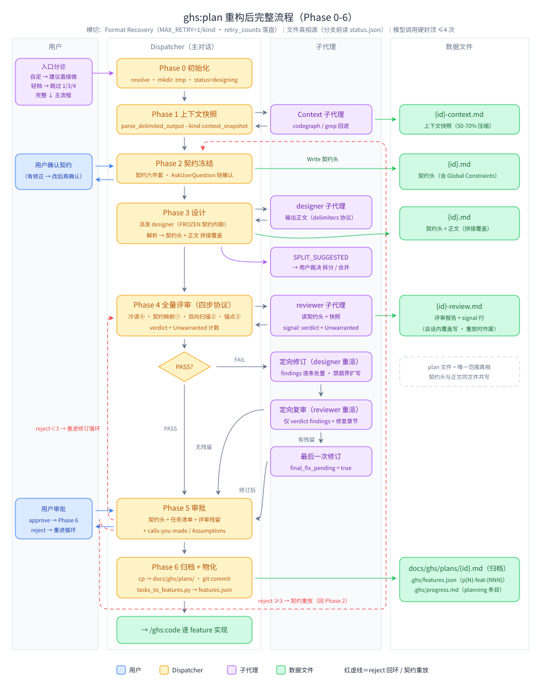

# ghs:plan 重构设计（Spec）

- 日期：2026-10-17
- 分支：`refactor/ghs-plan-skill`
- 状态：已裁决并复核（2026-10-17），待实施
- 前身材料：`docs/analysis/plan-mode-analysis.md`（v5，已删除）——本文件是其唯一权威后继

## 1. 意图与失效根源

要治的两个失效模式（GPT 系模型下实测）：

1. **小需求拉成大方案**；
2. **方案执行完后一堆 bug**。

机制根源（分析报告结论，此处只留结论）：

- 修订循环是**加法棘轮**：评审只罚遗漏不罚多余，每轮修订只加不减；
- 内容侧只有**裸训诫**（"Minimal change"），不可检、无检测；
- 需求澄清散在主对话**从不落盘**——designer/reviewer 共享对需求的同一种误读；
- plan 与 features 之间是**重新解读**：sprint 的上下文来源里没有 plan 文档，acceptance criteria 现场发明；
- 评审席位倒挂：plan 侧 5-7 轮重锤、code 侧零独立评审（本重构选择不在 code 侧补座，见 P7 预案）。

## 2. 北星约束（不可推翻）

1. **大范围重构被授权**：现有流程过于复杂、不 YAGNI；
2. **向 superpowers 靠拢**：搬质量哲学（生成时约束、自审文化、验收锚点），不搬形态；
3. **不拆 spec / plan 两个产物**：单一 plan 文档；
4. **plan 与下游（features）良好衔接**；
5. **借纪律，不借仪式**：判据、清单、锚点、准入标准照搬；TDD 红绿循环等流程仪式不进计划文档。

## 3. 目标 / 非目标 / 反目标

**Goals**

- 小需求不再膨胀：范围由用户确认的契约头锁定，评审具备删减力（Unwarranted）；
- 澄清落盘：契约头六件套是评审与物化的唯一范围基准；
- 主链收敛：plan 审批后自动物化 features.json，主链 = plan → code；
- 流程有出口：自足需求直接做，轻档零子代理；
- 评审环硬封顶：1 次全量 + 条件 1 次定向复审。

**Non-goals**

- 不拆出独立 spec 产物；
- 不改 ghs:code 的任何行为（P7 仅预案）；
- 不动 features.json 的消费方协议（ghs:code 读 features 的方式不变，P2.5 仅术语置换）；
- 分析报告（`docs/analysis/`）已删除，本 spec 为唯一权威文档。

**Anti-goals（做成了也算失败）**

- 重构后流程步数 / 产物数多于现状；
- 计划文档里出现 TDD 步骤剧本或测试组织指令；
- 出现任何新的多轮循环 / 协商 / 破例机制（breach 类）；
- 为"理论完整"新增座位或子代理。

## 4. 约束

- **模型档位：不设**（2026-10-17 裁决）——全链子代理（designer / reviewer / 快照 / builder check）一律使用 coding agent 默认模型，包括移除现状 Phase 0.5 对快照子代理的 `haiku` 指定；
- 仓库规范照旧：语言政策（LLM-facing 提示词英文、人读文档中文）、`command python3` 调用、conventional commits；
- **反棘轮**：每个新增必须对应一笔删减（各项"对应删减"见 §5）；
- **无向下兼容**：schema 正名后老项目 re-init 即可。

## 5. 各项设计（已裁决）

### P0 契约头（单产物内的 spec）

- 新增 **Phase 2 契约冻结**：dispatcher 汇总需求描述与澄清对话，写契约六件套 → **标准路径 +1 轻确认轮**（AskUserQuestion：展示六件套 + 单问"有无需要修正的"；若 Phase 0/1 已有澄清 AskUserQuestion，则搭载其最后一轮，零额外轮次）；
- **契约六件套**：intent / goals / non-goals / anti-goals（"即使做成了也算失败的东西"）/ 已定决策+裁量标记 / 留给实现方的空白；
- **冻结 = dispatcher `Write` 创建 `{plan_file}`**，内容为契约头；designer 之后产出的是**契约头之后的正文**，dispatcher 拼接写盘——契约不经 designer 的手，物理不可漂移；
- designer 模板删正文 Background/Goals 节（Scope 同理由契约头替代），正文从现状分析开始；
- 契约头内含 **Global Constraints 节**：一行一条、逐字精确值、无散文——它是 P2 物化的拷贝源；
- `-context.md`（架构快照）角色与快照追加机制不变。

**契约头模板**（标题用英文固定词——与任务卡标签一致、解析器友好；正文遵循仓库语言政策用中文）：

```markdown
# {Plan Title}

> SCOPE CONTRACT — frozen at kickoff. 由 dispatcher 维护并经用户确认；
> 正文不得扩大本契约范围，冲突时删正文不删契约。

## Intent
{一段话：为什么做这件事}

## Goals
- {可检验的目标，一条一行}

## Non-Goals
- {明确不做的事，说清边界在哪}

## Anti-Goals
- {"即使做成了也算失败"的失败判据}

## Decisions
- {已定决策一条一行；未经用户拍板、由 designer/dispatcher 裁量的项标 [DISCRETIONARY]}

## Open Space
- {明确留给实现方裁量、plan 不做决定的部分}

## Global Constraints
{一行一条，逐字精确值：格式、兼容性承诺、命名规范、端口等；无散文}
```

**对应删减**：不新增独立 spec 产物；正文 Scope/Goals 重复表述退役。

### P1 designer 全面重写

- **读者前提**：plan 的读者是"没见过这次对话的实现者 + features 物化器"，不是评审的架构师；
- **宪法条款**："A plan is the set of decisions the implementer cannot make alone"；
- **decision-complete**：不留任何实现者无法独自做出的决定；
- **双向失败判据**：欠决策（`TBD`/"处理边界情况"等决定不了的行）= 缺口；过决策（签名+锚点已确定的函数体）= 转录；
- **细节违约推定**（可检，替代 "Minimal change" 裸训诫）：不发明 schema / validation / fallback / 抽象层，除非 (a) 契约建立了它，或 (b) 它防止一个具体的、可指认的实现错误；
- **比例自审**：给标尺不给阈值——"设计体数倍长于契约头+任务尾之和 → 逐节自问：这节是决定还是转录？"；
- 交付前自审清单 ~5 条，自查不落盘；
- 模板三段式：**契约头（dispatcher）+ 设计体 + 任务尾（P2 定义）**。

**设计体节结构**（designer 产出区，标题英文固定词、内容中文）：

```markdown
## Current State
{仅保留理解决定所需的现状：相关模块职责、关键约束；
 快照已覆盖的内容引用而不复制}

## Design
{决定 + 一行理由。子节按需选用：总体方案 / 数据模型 / 接口设计（精确签名）/
 关键流程 / 错误处理——没有决定可写的子节整节省略，不为齐而写}

## Assumptions
- [ASSUMPTION] {决定} — {一行理由}
{无裁量项时写 None}

## Risks
{仅列出会改变决定的风险；缓解措施一行}
```

**对应删减**："完整覆盖需求"完备性文化（现 plan-designer.md:5 角色句与 :108-114 "Collaborating with the Reviewer" 节）；per-step checkbox 剧本（:78-88）；Testing Strategy 节（:96-98）；修订日志节（:116-118）。

### P2 任务节 = features.json 直接物化（plan 闭环）

**任务卡序列化格式**（解析器严格，`tasks_to_features.py` 的输入协议）：

```
### Task {N}: {title}
- Files: {精确路径，逗号分隔}
- Interfaces: {精确签名，可多行}
- Points: {实现要点，one-reasonable-thing 粒度——一句话说不清就拆}
- Anchors:
  - {测试名}: {断言要点}
  - {命令}: {预期输出}
  - [UNDEFINED-INPUT] {输入类别}: {不得崩溃的预期行为}
```

（`[UNDEFINED-INPUT]` 标签即 Review Focus 行的落账——"计划沉默但不得崩"的输入类别直接成为 owning task 的锚点，不设独立节。）

**`tasks_to_features.py`**（新脚本 + 测试，模式沿用 `parse_delimited_output.py`）：

- 调用：`command python3 ${CLAUDE_PLUGIN_ROOT}/shared/scripts/tasks_to_features.py --project-dir <PROJECT_DIR> --plan-file <PROJECT_DIR>/docs/ghs/plans/{plan_file}`；stdout 输出 JSON `{status, plan_id, feature_ids | reason}`；
- 触发：Phase 6 归档后由 dispatcher 自动调用；
- **verbatim 字段逐字**：id（`p{N}-feat-{任务序号，零垫 3 位}`，N = features.json 现有最大 plan 号 + 1）、title、description（=Points）、acceptance_criteria（=锚点逐字，且该 plan 的 Global Constraints 逐字置首）、files_affected、technical_notes（=Interfaces + 指向设计体节的引用）；
- **authored 字段确定性默认**：`status: "pending"`、priority=medium、estimated_complexity=medium、dependencies 按任务顺序（指向前序任务）；category 按 Files 路径启发式（路径含 `ui/`→ui、`api/`→api、`auth/`→auth、`data/`→data、`infra/`→infra，命中多个取首个，未命中 → core）；
- **plan 对象 schema 定稿**：必填 `id`（`"p{N}"`）/ `name`（显示用短标签，脚本从 Intent 首句截断）/ `status: "in_progress"` / `plan_ref`（归档路径）/ `created_at` / `features`；**现行 sprint 对象的 `goal`/`description` 散文字段删除**——名称与目标经 `plan_ref` 读 plan 文档契约头，文档是唯一真相（此为 plan_ref 的对应删减）；
- **约束传播粒度 = per-feature**：每个 feature 的 acceptance_criteria = [全量 Global Constraints 逐字] + [本任务锚点]——并行 code 子代理各自单读 feature 即得完整约束；
- **任务卡无 status 字段**——执行状态属 features.json，物化后全部 `pending`，plan 侧不追踪执行进度；
- 脚本追加一条最小 progress.md planning 条目（plan id、feature 数、来源 plan 文件）；
- 解析结果三态路由：`parsed(N)` → 写入；`no task zone` → 提示走 to-features；`malformed` → **定点重写任务节**（重派 designer：只重写任务尾使其符合序列化格式，契约头与设计体冻结不得改动；dispatcher 以"契约头 + 设计体 + 新任务尾"拼接覆盖写盘），仍失败问用户（跳过物化走 to-features / 修任务节）——物化失败发生在审批归档**之后**，禁止全量重新生成（会静默作废已通过的评审）；
- **锚点语法细则**：`- Anchors:` 下每条一行 `- {主体}: {判据}`；测试锚点用测试函数名（`test_refresh_rejects_expired: 过期 token 返回 401 且不落库`），命令锚点用可执行命令（`npm test -- --filter session: 无失败`）；**禁止空判据**（"works correctly" / "测试通过"）；每任务锚点 ≤5 条（超出 = 该拆任务的信号）。

- **主链 = plan → code**；`/ghs:plan` 结束语建议 `/ghs:code`；
- **"怎么测"划归 code 侧**：plan 只写锚点（WHAT 必须成立），测试先行与否、测试文件组织不写。

**对应删减**：sprint"重新解读计划"环节；原生路径 LLM 拆解的全部方差；提示词级约束传播（脚本物理保证逐字）。

### P2.5 to-features 正名（跨技能，纯机械，独立 commit）

- 技能：`ghs:sprint` → `ghs:to-features`（目录 `ghs-sprint/` → `ghs-to-features/`）；描述重写（English，LLM-facing）："Turn a plan document or raw requirements into atomic, implementable features in `.ghs/features.json`. Also use to modify existing plans — add features, change priorities, or replan."；
- schema：`sprints[]` → `plans[]`；ID `s{N}-feat-{NNN}` → `p{N}-feat-{NNN}`；正则 `^p\d{1,4}$` / `^p\d{1,4}-feat-\d{3}$` + 前缀一致性校验；feature 级字段不变；
- 落点 ~18 文件（含根 `README.md` / `README-zh.md`）；大小写不敏感的 "sprint" 在 `plugin/` 下实测 400+ 处（builder check 勘正：原估 ~88 仅计文档术语，实际含 Python 函数/变量名如 `get_completed_sprints`）——**验收标准 = `grep -ri sprint plugin/ README*.md` 归零**（内部标识符一并置换，不豁免）：

| 组 | 文件 |
|---|---|
| 技能本体 | `ghs-to-features/`（目录改名 + frontmatter + SKILL.md 16 处） |
| 资产 | `plugin/shared/assets/features.json` 模板 |
| 脚本 | `validate_structure.py`（报错加 "old format detected — re-run /ghs:init" 提示）、`status.py`、`parallel_utils.py`（路径 `<plan_id>`）、`archive_sprint.py` → `archive_plans.py` |
| 下游技能 | `ghs-code`（14 处）、`ghs-archive`（11）、`ghs-force-archive`（10）、`ghs-status`（4）、`ghs-init`（2）、`ghs-plan`（1，兜底建议语 → `/ghs:to-features`） |
| references | `sprint-agent.md` → `features-agent.md`、`coding-agent.md`、`examples.md` |
| 根 | `CLAUDE.md`（架构段管线描述 + Conventions 的 feature ID 格式） |

- **写入面与接口面同步换**：归档 JSON 键 `archived_sprint` → `archived_plan`、归档目录 `{plan_id}_{name}_{timestamp}`、并行 raw 路径 `.ghs/parallel/<plan_id>/`、`parallel_utils.py` 的 `--sprint-id` → `--plan-id`、progress.md 模板标题 `## Sprint Planning` → `## Feature Planning`（`archive_plans.py` 的会话匹配逻辑同步改，否则归档提取失效）；
- **归档产物格式变化属正名的一部分**：无向下兼容，旧 `.ghs/archived/` 内容不迁移（re-init 边界内）；
- 措辞注意：archive / status 文档中写"归档已完成 plan 的 **feature 组**"，避免读成归档 plan 文档；
- **行为零变更**；老项目 re-init。

**对应删减**："sprint" 时间盒仪式词汇退役（名实相符）。

### P3 评审环压缩（5-7 次模型调用 → 硬封顶 2-4 次）

**全量评审轮（唯一），先冷读后协议：**

| 步 | 内容 | 发现 → 修法 |
|---|---|---|
| ④ builder questions（P4，先做） | 冷读猎"需猜测且猜错代价大"的点 | 三堆处置（见 P4） |
| ① 契约映射 | 正文每主要节、每任务映射契约条目 | 映射不上 = **Unwarranted**（阻塞）→ 整节删除；契约漏了 = **缺陷上报**转用户裁决（不删） |
| ② 双向失败扫描 | P1 同款尺 | 欠决策 = Severe → 补决定；过决策 = Medium → 削到决定级 |
| ③ 锚点完整性 | 每任务 ≥1 非空锚点；风险输入有 `[UNDEFINED-INPUT]`；空锚点抽查 | 缺失 = Medium → 补 |

三步中浮现的质量问题（竞态、安全、错误假设）照常以 Severe/Medium/Optimization 标注。**PASS = 零 Unwarranted + 零 Severe + 零 Medium**。

**封顶流程**（替代多轮循环）：

```
Phase 4 评审 PASS → Phase 5 审批                      （1 次模型调用，常态路径）
Phase 4 评审 FAIL → 定向修订 → 定向复审 → Phase 5 审批  （3 次）
复审仍有残留 → 用户三选：再修一次（最后一次，无复审）/ 带瑕疵接受 / 中止   （硬边界 4 次）
Phase 5 reject（用户主动）→ 定向修订（无模型评审）→ 回审批
连续 ≥3 次 reject → 建议契约重放（回 Phase 2 改契约再冻结）
```

（定向修订与定向复审是 **Phase 4 的内部循环**，对应状态机 reviewing↔revising 迁移，不单独编号；契约重放是 **Phase 5 → Phase 2 的显式回边**。）

- **定向修订**：findings 逐条处置（Unwarranted→删 / 欠决策→补 / 过决策→削），禁止 findings 之外扩写；
- **定向复审**：仅 verdict 上轮 findings（ADDRESSED / NOT ADDRESSED）+ 检查修复章节新破绽，非全量重评；"Attempted ≠ addressed"；复审复用同一 signal 行格式与同一 `-review.md`（覆盖写），"评审残留"取自最新 review 文件；
- **契约重放机制**（连续 ≥3 reject 或用户主动发起）：同一 `{plan_file}` 原地覆盖——dispatcher 写新契约头，旧正文整体作废删除（它映射的是旧契约）；`-review.md` 覆盖写；status 回 `designing`，`reject_count` 与 retry_counts 归零，全新 Phase 3；重放后走正常 Phase 2 契约确认轮；
- signal 行加 Unwarranted 计数：`REVIEW COMPLETE | Verdict: PASS|FAIL | Unwarranted: X Severe: Y Medium: Z Optimization: W`（`parse_delimited_output.py` + 测试小改）；
- status.json：删 `max_rounds` / `max_rounds_breaches` / `round` / `rejected` 枚举；状态集 = `designing | reviewing | revising | pending_approval | approved | aborted`（7→6）；`accepted_with_fail` 保留，语义收窄为"复审后仍有残留且用户显式接受"；
- **审批面 = 契约头 + 任务清单 + 评审残留 + calls-you-made/Assumptions**（现状 34 行摘要组装逻辑整体删除——契约头是 dispatcher 自己写的，组装成本 ≈ 0）。

**status.json schema**：

```json
{
  "plan_file": "{date}-{slug}.md",
  "context_file": "{date}-{slug}-context.md",
  "status": "designing | reviewing | revising | pending_approval | approved | aborted",
  "lane": "light | full",
  "retry_counts": {"plan": 0, "review": 0, "context_snapshot": 0},
  "reject_count": 0,
  "final_fix_pending": false,
  "accepted_with_fail": false,
  "keep_raw_on_success": false,
  "created_at": "YYYY-MM-DDTHH:mm:ss",
  "updated_at": "YYYY-MM-DDTHH:mm:ss"
}
```

（`lane: light | full` 随 Phase 0 入口分诊写入；契约冻结状态不进状态机——plan 文档本身即真相。两个封顶计数字段：**`reject_count`** = Phase 5 审批被拒累计，≥3 → 建议契约重放（软建议非硬闸）；**`final_fix_pending`** = 定向复审留残留时置 true，置位期间仅允许一次定向修订且不再复审，进入 pending_approval 或 aborted 时清除——"硬边界 4 次"的落盘形态，跨重启不失位，是 P6"文件真相源"原则的必然推论。）

**评审报告骨架**（plan-reviewer.md 重写稿的输出结构）：

1. **需求复述**——三句话，随报告落盘，审批面供用户对比；
2. **契约映射表**——正文各主要节 → 契约条目对照，映射不上者入 Unwarranted；
3. **Findings**——按 Unwarranted / Severe / Medium / Optimization 分级，每条带位置与修法方向（Unwarranted 的修法恒为"删除"）；
4. **锚点检查**——缺失 / 空锚点清单；
5. **Contract Deficiency**（可选节）——判定为"契约漏了而非正文多了"的项，转用户裁决；
6. signal 行（`REVIEW COMPLETE | ...`）。

**对应删减**：多轮 revise 循环、breach/MAX_BREACHES、`rejected` 死枚举、max_rounds 协商、修订日志、12 项 checklist、Plan Summary 节、现行评审/审批分支树 ~70%。

### P4 builder-check 合并进评审席（评审第④步）

- **准入唯一**："实现者不得不猜、且猜错代价大"——能从契约推出的不算，猜错无所谓的不算；
- **三堆**：契约已答（引契约原文，指出正文未吸收）/ 模型可裁（自行定夺 + Assumptions 标记）/ 只有用户能答（重要性排序交 dispatcher）；
- **堆 3 → 单轮封顶**：≤5 问、一次批式 AskUserQuestion、每问 2-4 互斥选项 + 推荐默认；封顶后未决落 Assumptions 而非追问；
- 答案 + findings **合并进一次** designer 派发（FAIL 时即同一次定向修订；PASS 时一次 touch-up——touch-up 是用户答案的落实，无复审）；
- **需求复述**：评审报告头部三句话复述理解的需求，随报告落盘，审批面供用户对比"评审者理解的需求"vs"我要的需求"；
- **Assumptions 格式**：每条 = `[ASSUMPTION]` 标记 + 决定 + 一行理由；
- **QUESTION 双通道退役**：designer QUESTION 信号（SKILL.md :391/:399）、reviewer QUESTION（:513/:520）、"one question at a time" 全局约束（:667 → 改为"单轮封顶、批式提问"）；designer 改**裁量文化**（能定则定 + Assumptions 标记 + 高代价猜测必须显式标记）。

### P5 入口分诊 + 分解闸门

| 档 | 判据信号（启发式，非硬阈值） | 路径 | 交互 |
|---|---|---|---|
| 自足 | 点名确切文件与改法、无设计空间 | 建议直接做并退出 | 一句建议 |
| 轻档 | 单子系统、≤~3 文件、无新接口/schema、无架构决定、描述短 | dispatcher 直出契约头 + 单任务卡 → 1 轮审批 → 物化；跳过 Phase 1 快照与 Phase 3/4；允许 dispatcher 少量直接读文件定位路径 | 1 轮 |
| 完整 | 其余一切 | 全流程 | 流程内已定 |

- **降档告知、升档默认**：往轻档/自足走须告知用户（可随时升档），往完整档走不问（零强制交互轮）；
- **轻档单轮合并**：轻档唯一一轮交互 = AskUserQuestion 同时承载契约确认与任务卡审批（展示契约头 + 单任务卡，选项：确认物化 / 调整后物化 / 升完整档）；
- **第二道闸门**：designer 发现方案横跨多个无共享契约的独立子系统 → 输出 `SPLIT_SUGGESTED: {理由 + 建议子 plan 划分}` → 用户裁决：拆分（当前 plan 转 aborted + 记录建议）/ 合并（附理由重派 designer）；评审①步契约映射兜住漏网者；
- 状态机零新增状态。

### P6 机制收尾（随 P3 同稿落地）

- **轻量状态纪律 ~5 行**（不立协议名目）：写穿（状态变更与文件写入同轮完成）；剩余 ~3 个分支点"分支前 Read status.json、只以刚读到的值分支"；Key Constraints #4 追加"文件是 dispatcher 自身状态的唯一真相源"；
- status.json 增 `"retry_counts": {"plan": 0, "review": 0, "context_snapshot": 0}`（持久化，成功解析归零——修跨重启 MAX_RETRY 失效的真缺陷）；
- **C1 原稿的 G1-G5 状态对账协议不搬运**（线性流程用不上；反棘轮）。

### P7 code 侧评审席：纯预案（不实施）

- **触发器**：P0-P6 落地后执行侧 bug 率仍困扰；
- 届时**接入而非新建**：P2 已预埋全部接口——验收锚点 = 评审对照物、files_affected = 范围核查、plan_ref = 溯源通道；
- 设计草图（存档用）：SDD task-reviewer 纪律（diff-based、实现者报告 = 未验证声称、Missing/Extra/Misunderstood + 严重度）+ plan-mandated 上报人裁决；
- **ghs:code 零改动**（连上报规则也不加）。

### 规模边界与大需求适配（已知边界）

- **安全区：单份 plan ≤ ~800 行**——Phase 3 设计体由 designer 单次派发产出，输出 token 上限与长文尾部衰减（生成点远离契约导致纪律松动）共同决定的安全边界；
- 超出安全区的需求，正解是**拆分而非放大**：多独立子系统 → `SPLIT_SUGGESTED` 闸门拆为多份 plan（各走完整流程）；同域分里程碑 → 以契约 Non-Goals 切片，分多个 plan run，每份自带冻结契约与验收锚点；
- 契约头 / Unwarranted 删减 / 定向修订 / 机械物化的成本均为 **O(范围) 或线性**，不随行数恶化——拆分后的每一份都完整享受本流程，且规模越大冻结基线的收益越大；
- **已知边界**：不可拆分的单子系统超大需求（真 1500 行级）需"分批生成协议"（设计体 + 任务尾分批派发、按段评审）——本期不设计（反棘轮：无真实案例不加机制）；触发条件 = 实际出现此类需求，届时按证据补充设计。

## 6. 交付物清单（文件级）

| 文件 | 动作 |
|---|---|
| `plugin/skills/ghs-plan/SKILL.md` | 重写，**全新 Phase 编号 0-6**：0 初始化 + 入口分诊（三档路由 + 轻档支路）、1 上下文快照（去 haiku 指定）、2 契约冻结、3 设计（新 prompt 模板 + 契约内联）、4 评审（四步协议 + 内部定向修订/复审循环）、5 审批（新审批面 + reject 契约重放建议）、6 归档+物化；状态机清理（7→6、删 breach 机器）；Format Recovery 收窄（删 MAX_BREACHES、增 retry_counts）；QUESTION 机制退役 |
| `plugin/shared/references/plan-designer.md` | 全面重写：P1 纪律 + 契约头/设计体模板 + P2 任务卡格式 + Assumptions 格式 + 裁量文化 |
| `plugin/shared/references/plan-reviewer.md` | 全面重写：冷读 + 四步协议（含④ builder questions）+ Unwarranted 判例 + 定向复审模板 + 需求复述 + 三堆报告格式 |
| `plugin/shared/scripts/tasks_to_features.py` + `test_tasks_to_features.py` | 新增 |
| `plugin/shared/scripts/parse_delimited_output.py` + 测试 | signal 行 Unwarranted 计数小改 |
| P2.5 的 ~18 文件 | 机械置换（独立 commit） |
| 根 `CLAUDE.md` | 架构段管线描述（plan → code 主链、to-features 入口）+ Conventions 的 feature ID 格式 + 三角色描述更新 |

P7 预案不在本表（见 §5 P7）。

## 7. 实现规格裁定记录（2026-10-17，用户授权裁定）

原"留给实现方的空白"已按用户授权（"任务卡状态、设计体结构等规格你来裁定"）全部落定：

| 裁量点 | 裁定 |
|---|---|
| 设计体节结构 | Current State / Design / Assumptions / Risks 四节；标题英文固定词、内容中文；无决定可写的子节整节省略（§5 P1） |
| 任务卡 status | 任务卡无 status 字段；执行状态属 features.json，物化后全部 `pending`（§5 P2） |
| tasks_to_features.py CLI | `--project-dir` + `--plan-file`，stdout JSON 三态；category 路径启发式规则见 §5 P2 |
| 锚点语法 | `{测试名或命令}: {判据}`；禁空判据；每任务 ≤5 条（§5 P2） |
| status.json schema | 六状态 + lane + retry_counts + 封顶计数（reject_count / final_fix_pending）；契约冻结不进状态机（§5 P3） |
| 评审报告骨架 | 需求复述 / 契约映射表 / Findings / 锚点检查 / Contract Deficiency / signal 行（§5 P3） |
| 轻档单轮 | 契约确认与任务卡审批合一（§5 P5） |
| **封顶计数落盘**（builder Q1） | status.json 增 `reject_count` + `final_fix_pending`——落盘是"文件真相源"原则的必然，不做内存推导（§5 P3） |
| **物化失败重派语义**（builder Q2） | 定点重写任务节、契约头与设计体冻结；禁止全量重新生成（§5 P2） |
| **plan 对象 schema**（builder Q3） | 必填 id/name/status/plan_ref/created_at/features；删 `goal`/`description` 散文字段（plan_ref 的对应删减）（§5 P2） |
| **P2.5 扫除边界**（builder Q4） | 验收 = `grep -ri sprint plugin/ README*.md` 归零（400+ 处含代码标识符）；写入面/接口面/progress.md 标题同步换；归档格式变化随正名（§5 P2.5） |
| **契约重放机制**（builder Q5） | 原地覆盖新契约头、旧正文作废、status 回 designing、计数归零、全新 Phase 3（§5 P3） |
| **README 纳入**（builder Q6） | `README.md` / `README-zh.md` 纳入 P2.5（§5 P2.5） |
| **约束传播粒度**（builder Q7） | per-feature：每 feature 的 acceptance_criteria = 全量约束逐字 + 本任务锚点（§5 P2） |
| 实施范围 | **P0-P6 + P2.5 一次完成，不分期**（2026-10-17 裁决）；P7 预案除外 |
| commit 拆分 | ① P2.5 正名独立 commit；② P0+P1（SKILL.md 设计侧 + designer.md）；③ P2（脚本 + Phase 6 + parser）；④ P3+P4（reviewer.md + 评审环 + 状态机）；⑤ P5+P6（分诊 + 状态纪律收尾） |
| 标题语言 | 文档模板标题用英文固定词（与任务卡标签一致、解析器友好），内容遵循仓库语言政策用中文 |

> builder check 的堆 2（模型可裁）各项——拼接覆盖语义、Unwarranted 独立计数不与 Severe 叠加、现状分析节映射到 intent 不判 Unwarranted、dependencies 按任务顺序成链、审批面软上限——已核对采纳；小勘误（assets 实际路径 `plugin/shared/assets/features.json`、置换位点计数口径）已修入正文。

仍留给实施期的只剩**写作**而非设计：全部提示词的具体文案、契约头/任务卡的正反例示教、判据表例证选择——实施时直接写，无需再裁决。

## 8. 已裁决记录（2026-10-17，9/9）

| 决策 | 裁决 |
|---|---|
| 契约确认交互（原 #8） | 标准路径 +1 轻确认轮；有澄清对话则搭载最后一轮 |
| 评审轮次（原 #9） | 1 次全量 + 条件 1 次定向复审（E2 语义，仅修订后触发） |
| builder-check 形态 | 合并评审席第④步，不设独立子代理 |
| 任务物化方式 | `tasks_to_features.py` 脚本，plan Phase 6 自动调用；主链 plan → code |
| sprint 技能去向 | 行为零变更 + P2.5 正名 to-features；schema `sprints[]` → `plans[]` |
| 向下兼容 | 无；老项目 re-init |
| P7 / ghs:code | 纯预案触发式，零改动（连上报规则也不加） |
| 模型档位（原 #6） | **不设**——全链子代理用 coding agent 默认模型（含移除现状快照 haiku 指定） |
| 实现规格（设计体结构/任务卡状态/CLI/commit 拆分等） | 用户授权 Claude 裁定，记录见 §7 |
| 分析报告 | 已删除（v5 为终版）；本 spec 为唯一权威文档 |

## 9. 新机制总览（完整流程对照）

> 本章是 §5 各项设计的**组装视图**：完整走一遍新流程的每一步——谁做什么、读写哪些文件、有哪些控制点——供整体确认机制用。



> 图例：红虚线 = reject 回环与契约重放。图中节点与下表逐步对应，冲突时以表为准（表承载细节）。

### 9.1 分步叙述

> 新流程使用**全新整数编号 Phase 0-6**（不沿用旧流程的 0.5/0.6/2a/3a 增补式编号）：0 初始化 → 1 上下文快照 → 2 契约冻结 → 3 设计 → 4 评审（修订/复审为内部循环）→ 5 审批 → 6 归档+物化。契约重放是 Phase 5 → Phase 2 的回边，不是独立阶段。

| # | 步骤 | 参与者 | 动作与控制点 | 读写的文件 |
|---|---|---|---|---|
| 0 | 初始化 + 入口分诊 | dispatcher | `resolve_project_dir.py` 定位项目；`mkdir -p .ghs/plans/.tmp`；生成 `{date}-{slug}` 标识；写初始状态。入口分诊三档：自足 → 出口 X；轻档 → 支路 L；完整 → 继续 | 新建 `{id}-status.json`（`status: designing`） |
| 1 | 上下文快照 | Context 子代理 | 探测 codegraph → 派 general-purpose（codegraph 路径）或 Explore（grep 回退）产快照；输出经 `parse_delimited_output.py --kind context_snapshot` 提取；失败走 Format Recovery（`retry_counts.context_snapshot`） | 写 `{id}-context.md`；只读项目源码 |
| 2 | 契约冻结 | dispatcher + 用户 | 汇总需求描述与澄清对话 → 起草契约六件套 → AskUserQuestion 轻确认（有修正则原地改后再确认，确认即冻结） | **`Write` 创建 `{id}.md` = 契约头**（含 Global Constraints 节） |
| 3 | 设计 | Plan 子代理 + dispatcher | 派发 prompt：内联 FROZEN 契约全文 + context.md 指引 + 设计体/任务卡规格；子代理输出 `<<<PLAN_START>>>正文<<<PLAN_END>>>`；dispatcher 解析后以"契约头 + 正文"**拼接覆盖写**；子代理可输出 `SPLIT_SUGGESTED` → 用户裁决拆分/合并 | 读 `{id}-context.md`；写 `{id}.md` |
| 4 | 全量评审 + 内部修订循环 | reviewer / designer 重派 | 读 `{id}.md`（**头部即契约，先读**）+ context.md；四步协议：冷读猎题④ → 契约映射①（映射不上 = Unwarranted）→ 双向失败扫描② → 锚点完整性③；signal 行带 `Unwarranted: X` 计数。PASS → `pending_approval`；FAIL → `revising` → 单轮定向修订（findings 逐条处置：Unwarranted→删 / 欠决策→补 / 过决策→削；禁超界扩写）→ 定向复审（仅 verdict 上轮 findings + 检查修复章节）：无残留 → `pending_approval`；有残留 → `final_fix_pending: true` → 最后一次修订（无复审）→ `pending_approval`。**修订/复审是本 Phase 的内部循环**（状态机 reviewing↔revising） | 写 `{id}-review.md`；覆盖写 `{id}.md`（修订）；分支前读 `{id}-status.json` |
| 5 | 审批 | 用户 | 审批面 = 契约头 + 任务清单 + 评审残留 + calls-you-made/Assumptions；approve → Phase 6；reject → `reject_count++`：＜3 按反馈定向修订回审批；≥3 → **建议契约重放**（Phase 5 → Phase 2 回边：同一 `{id}.md` 原地覆盖新契约头、旧正文作废、review 覆盖写、status 回 `designing`、`reject_count` 与 retry_counts 归零、全新 Phase 3；用户亦可主动发起） | `{id}-status.json` 状态迁移；重放时覆盖 `{id}.md`、`{id}-review.md` |
| 6 | 归档 + 物化 | dispatcher + 脚本 | `cp {id}.md → docs/ghs/plans/` + git commit（accepted_with_fail 时消息带标记）→ `tasks_to_features.py` 解析任务尾 + 契约 Global Constraints → 写 features.json（plan 对象 + `p{N}-feat-{NNN}`）+ 追加 progress.md 条目 → `status: approved` → 结束语建议 `/ghs:code` | 写 `docs/ghs/plans/{id}.md`、`.ghs/features.json`、`.ghs/progress.md` |
| L | 轻档支路 | dispatcher + 用户 | Phase 0 分诊判轻档 → 跳过 Phase 1/3/4，dispatcher 直出契约头 + 单任务卡 → 单轮合并审批（确认物化 / 调整后物化 / 升完整档）→ 汇入 Phase 6 | 同上；**零子代理** |
| X | 自足出口 | dispatcher | Phase 0 分诊判自足 → 建议直接做，流程退出 | 无 |

### 9.2 状态机（6 态）

| 从 | 触发 | 到 |
|---|---|---|
| designing | Phase 3 正文落盘，送审 | reviewing |
| reviewing | 评审 PASS / 复审通过 / 最终修订完成 | pending_approval |
| reviewing | 评审 FAIL | revising |
| revising | 修订产出送定向复审；复审完成回填 | reviewing |
| pending_approval | 用户 approve | approved（终态） |
| pending_approval | 用户 reject（`reject_count` ＜3） | revising |
| pending_approval / 任意 | 契约重放 | designing（计数归零） |
| 任意 | 用户中止；拆分采纳 | aborted（终态） |

### 9.3 控制文件清单

| 文件 | 写者 | 读者 | 生命周期 |
|---|---|---|---|
| `.ghs/plans/{id}-status.json` | dispatcher | dispatcher（**分支前必读**） | 会话期；approved / aborted 后保留供审计 |
| `.ghs/plans/{id}.md` | dispatcher（Phase 2 Write 契约头；Phase 3/4 拼接覆盖写） | designer（prompt 内联契约）、reviewer、用户（审批） | 归档后在 `.ghs/` 原样保留 |
| `.ghs/plans/{id}-context.md` | Context 子代理（经 dispatcher）；快照追加机制可补充 | designer / reviewer | 会话期 |
| `.ghs/plans/{id}-review.md` | reviewer（经 dispatcher） | dispatcher（残留进审批面）、用户 | 覆盖写；重放时作废 |
| `.ghs/plans/.tmp/*.raw` | dispatcher（解析输入暂存） | `parse_delimited_output.py` | 即用即删 |
| `.ghs/plans/{id}-*.raw[.retryN]` | dispatcher | 用户（排障） | 仅错误路径或 `keep_raw_on_success` |
| `docs/ghs/plans/{id}.md` | dispatcher（Phase 6 cp + commit） | 人；code 侧经 `plan_ref` | 永久归档 |
| `.ghs/features.json` | `tasks_to_features.py`（本流程唯一写点）；ghs:code 运行期 | ghs:code、to-features、status / archive | 永久 |
| `.ghs/progress.md` | 脚本追加 planning 条目 | 人 / archive | 永久 |

### 9.4 横切机制

- **Format Recovery**：每类子代理（plan / review / context_snapshot）独立计数，`MAX_RETRY = 1`，计数持久化于 `retry_counts`（成功解析归零）；格式恢复 appendix 按类附加；post-mortem `.raw` 仅错误路径落主目录。**物化失败的恢复是定点重写任务节（正文冻结）**，不与全量格式恢复混用；
- **User Decision Handling**：重试耗尽时三选（再试 / 接受 fallback / 中止），语义与现状一致；
- **文件真相源**：dispatcher 在每个分支点先 Read status.json、只以刚读到的值分支；封顶由落盘计数执行（`reject_count` / `final_fix_pending`），跨重启不失位；
- **终止保证**：评审-修订环的模型调用硬封顶 = 全量评审 1 + 定向修订 1 + 定向复审 1 + 最终修订 1 = **4 次**（首轮 PASS 的常态路径仅 1 次；不含 Phase 3 首次设计与 Phase 5 用户反馈修订）；用户侧 reject 循环无硬闸，≥3 触发契约重放建议（软着陆）。

### 9.5 外部接口

- **下游**：`/ghs:code` 读 features.json 逐 feature 实现；`plan_ref` + technical_notes 的"参考 plan §X"回读协议不变；
- **外来入口**：非 ghs:plan 产出的计划文档 / 裸需求 → `/ghs:to-features`（LLM 分解，行为不变）——ghs 去掉 plan 技能仍是完整可运转的执行半套件；
- **产线汇合**：完整档与轻档在 Phase 6 汇合，共用 `tasks_to_features.py` 物化。
